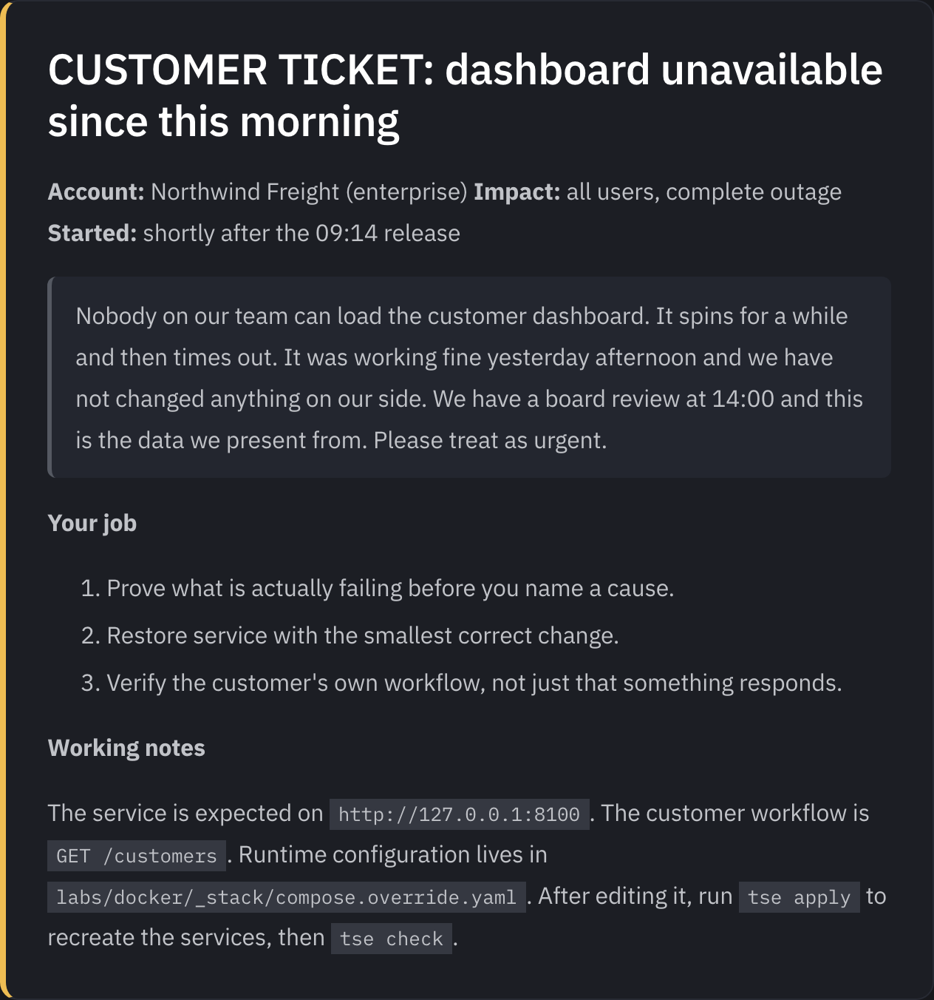
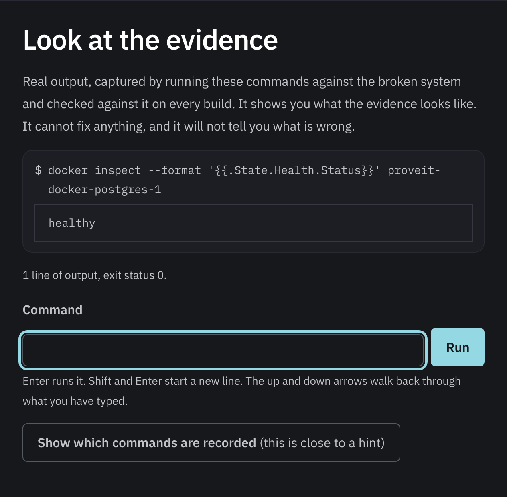

# Prove It

[](https://github.com/h-vance/prove-it-labs/actions/workflows/verify.yml)
[](https://github.com/h-vance/prove-it-labs/actions/workflows/site.yml)
[](https://github.com/h-vance/prove-it-labs/actions/workflows/security.yml)
[](LICENSES/)


A hands-on Technical Support Engineering course. You get a customer ticket, a
genuinely broken system, and no hint about which layer failed. You investigate.



The course site is at [h-vance.github.io/prove-it-labs](https://h-vance.github.io/prove-it-labs/).
Exercise pages are generated from the labs. Their terminals replay recorded
output; they are not remote shells. Completing an exercise requires fixing the
local system and running its grader.





Regenerate the demo with `npm --prefix site run demo` and screenshots with
`npm --prefix site run screenshots` after building the site.

## Start

Open the repository in a Codespace, wait for the container to build, then:

```bash
tse start docker/01
```

That provisions a broken system and prints the ticket. Investigate it with
ordinary tools. When you think you have fixed it:

```bash
tse check
```

The grader never just says pass or fail. It shows the assertion, the command it
ran, and the raw output it evaluated:

```
FAIL  Customer workflow returns their data
      $ curl -s --max-time 3 http://127.0.0.1:8100/customers
      (no output)
      Expected: {"status": "ok", "customer_count": 10} from /customers
```

Running locally instead of in a Codespace needs Docker, `curl`, and
Python 3.9 or newer, which on a Mac means the one already there. Two tracks
want a little more: Kubernetes needs `kubectl` and `kind`, and the API and
observability tracks need `jq`. Nothing else, and nothing to build.

`tse doctor` is the list, grouped by what needs what, so a gap costs you one
track rather than leaving you guessing:

```bash
tse doctor
```

## The commands

| Command | What it does |
|---|---|
| `tse list` | Every exercise, with time estimates and your progress |
| `tse start <id>` | Provision an exercise and print its ticket |
| `tse check` | Grade the active exercise, showing the evidence used |
| `tse hint` | Reveal the next hint. They escalate rather than dump |
| `tse answer` | Root cause, customer update, and escalation wording |
| `tse apply` | Recreate the services after you edit the configuration |
| `tse reset` | Return to the state described in the ticket |
| `tse quiz` | Answer the exercise's questions and see why |
| `tse progress` | See your progress, or export it for the site's proof record |
| `tse doctor` | Check this machine can run the labs |
| `tse record` | Capture real output for the site's terminal |
| `tse leaks` | Scan committed files for anything from a real machine |
| `tse new` | Scaffold a new exercise |

## How the exercises work

Everything is built around one question, borrowed from how infrastructure
support actually happens:

> What can I prove for the customer right now?

Not "what technology am I studying today." Each exercise proves exactly one
operational fact, and the technology sits underneath it. You are not asked to
memorize commands. You are asked to say what a command proved, and just as
importantly, what it did not.

Every exercise has the same shape, so there is never a surprise about where to
look:

```
ticket.md       the customer symptom, and nothing else
setup/          the broken state
check.sh        the assertions, and the evidence behind them
hints/          three escalating nudges
solution.md     root cause, the fix, and the words you would send
questions.json  three questions on what the evidence proved
commands.txt    the commands worth replaying on the site
transcript.json their real output, captured and re-verified in CI
```

## The terminal on the site is a replay, not a shell

Every exercise page carries a terminal you can type into. It replays output
captured by genuinely running those commands against the broken system, and CI
re-runs all of them against a freshly provisioned stack on every push. If a byte
of the evidence has moved, the build fails rather than the page quietly showing
something that is no longer true.

It will not replay `tse check`, `tse hint` or `tse answer`. The first two are
obvious; the third is the interesting one, because `tse check` states the
expected fixed state in order to assert it, so recording that would hand over
the diagnosis through the back door. Commands that were never recorded are told
so plainly rather than given invented output.

Nothing typed into a page can finish an exercise. That still means changing a
real system.

## Learning format

Exercises start with a symptom-only ticket, a time estimate, and three
progressive hints. Grading shows the command, assertion, and observed output.
Customer updates and escalation notes are graded separately from technical
repairs. A short session can be one ticket, one command, and one statement of
what the evidence proves.

The [proof page](https://h-vance.github.io/prove-it-labs/proof) imports
`tse progress --json`. Progress stays in the browser; there is no account or
upload. Reading hints or answering questions does not count as repairing a lab.

## Tracks

| Track | Exercises | Status |
|---|---|---|
| Docker | 3 | Available |
| APIs | 4 | Available |
| Kubernetes | 5 | Available |
| SQL and PostgreSQL | 3 | Available |
| Mixed incidents | 2 | Available |
| Customer communication | 2 | Available |
| Linux and CLI | 2 | Available |
| Networking, DNS, TLS | 3 | Available |
| Observability | 2 | Available |

Twenty-six exercises across all nine tracks. Related tickets can share the same
symptom but have different causes. Mixed incidents require identifying the
system involved; communication exercises assess a written update or escalation
against supplied evidence and a rubric.

The optional [Intercom integration](integrations/intercom/README.md) files an
API-stack failure as an Inbox conversation in a sandbox workspace.

The Kubernetes track needs a cluster. `tse` creates and reuses one for you:

```bash
tse cluster up       # once, takes about a minute
tse cluster status
tse cluster down
```

## Verification

Every exercise is asserted in CI to **fail in its broken state and pass against
its documented solution**. An exercise that passes while broken is not broken,
and one that fails when fixed is not solvable, so both halves are checked.

```bash
tools/tse verify                # every exercise, both states
tools/tse verify docker/02      # one exercise
tools/tests/smoke.sh            # the CLI surface and the full learner loop
tools/tests/smoke.sh --fast     # skip the parts that need Docker
python3 tools/tests/test_meta.py
python3 tools/tests/test_content.py
```

`test_content.py` enforces the editorial rules mechanically, including the one
that matters most: a ticket that names the failing layer fails the build.

One command runs all of it, and it is the one to run before opening a pull
request:

```bash
tools/tests/preflight.sh
```

[AUDIT.md](AUDIT.md) records the August 2026 review, its findings, and known
limits. Current checks live in `tools/tests/` and `site/scripts/`.

## The site

The course site is an Astro Starlight build in [`site/`](site). Exercise pages
are **generated from the labs**, so a page cannot drift from the exercise it
documents and adding an exercise needs no site change at all.

```bash
cd site
npm install
npm run dev           # http://localhost:4321/prove-it-labs
npm run build
npm run check:pages    # every exercise has a complete page, inside its weight budget
npm run check:terminal # the terminal replays what was actually recorded
npm run a11y           # WCAG 2.2 AA, every page, light and dark
```

The accessibility gate is a gate, not a report: CI fails on any violation, in
either theme, and it drives the components rather than scanning them at rest.

`check:pages` also holds each built exercise page and the total JavaScript to a
budget. Recorded output is embedded in the pages, so without that the terminal
could grow every page indefinitely and nothing would say so.

Contributions are welcome. See [CONTRIBUTING.md](CONTRIBUTING.md).

## How this was built

Built by Harrison Vance with Claude (Anthropic). The verification commands above
check the implementation; the historical audit records its scope and limits.

## License

Code is MIT. Course content, meaning lessons, tickets, solutions, and
reference material, is CC BY 4.0. See [LICENSES/](LICENSES/).
